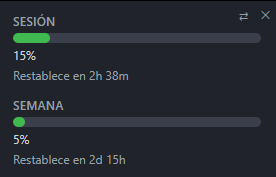
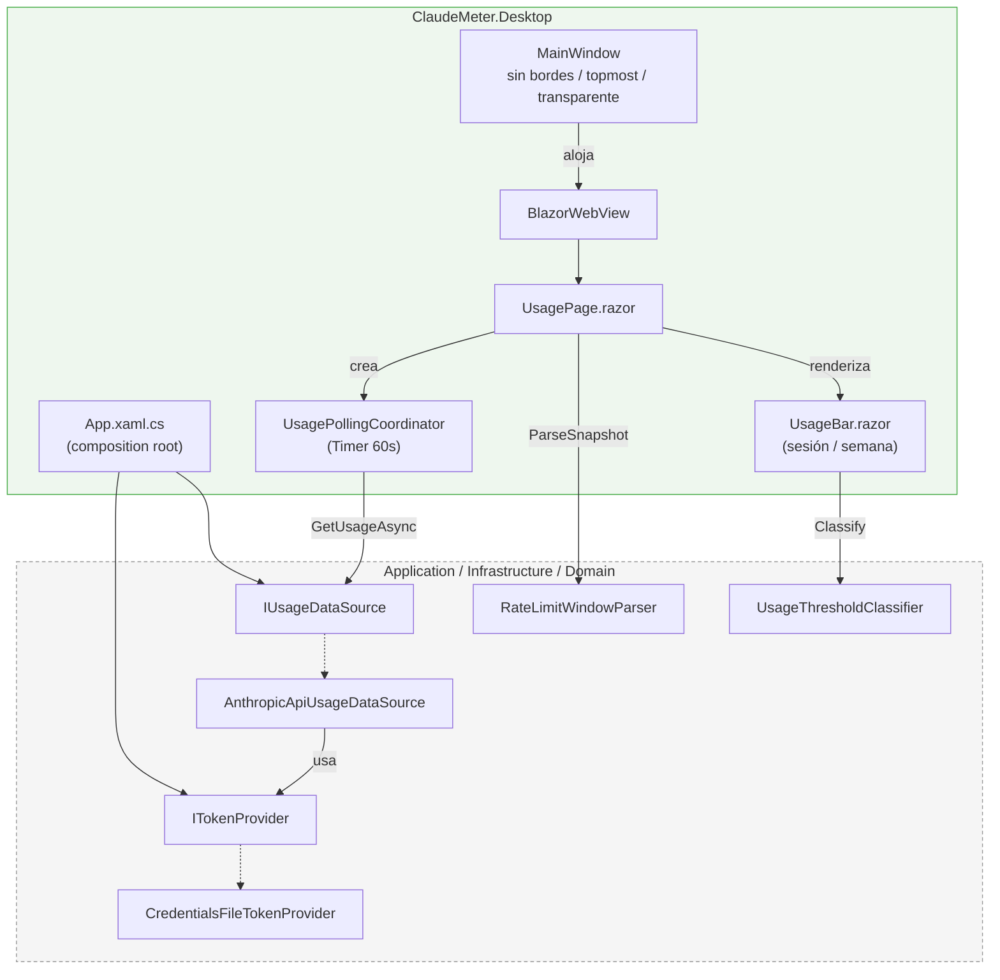

# ClaudeMeter .NET

[](https://github.com/AlejBlasco/claude-usage-widget/actions/workflows/ci.yml)
[](https://github.com/AlejBlasco/claude-usage-widget/releases)
[](./LICENSE)


Widget de escritorio para Windows que muestra en tiempo real el consumo de cuota de **Claude Code** — sesión, semana y countdown hasta el reset — sin salir del escritorio. Ventana sin bordes, siempre encima, con barras por umbral (verde / ámbar / rojo) y una mascota reactiva ("Clawd").

<p align="center">
  
  &nbsp;&nbsp;
  
</p>

*Capturas reales (tema oscuro): las barras de sesión y semana, y la mascota "Clawd". Verde por debajo del 70%, ámbar entre 70-90%, rojo a partir del 90%.*

> Proyecto personal y **no oficial**: sin afiliación con Anthropic.

## Características

- **Barras de sesión y semana** con color por umbral y countdown animado hasta el reset.
- **Mascota "Clawd"**: segunda pantalla que refleja el estado de la cuota de un vistazo.
- **Tema claro/oscuro**, arrastrable (la posición se recuerda), click-through opcional y auto-ajuste de altura.
- **Icono de bandeja** con Pausar/Reanudar, Recargar, Ignorar clics, Iniciar con Windows y Salir.
- **Robusto**: reintentos con backoff, logging estructurado (Serilog) y aviso claro ante 401/403.
- **Instalador y actualizaciones automáticas** (Velopack), con versionado automático (Nerdbank.GitVersioning).

## Instalación

Descarga `ClaudeMeter-win-Setup.exe` (o el zip portable `ClaudeMeter-win-Portable.zip`) desde la [última release](https://github.com/AlejBlasco/claude-usage-widget/releases/latest). El instalador es de un clic, se actualiza solo (Velopack) y no requiere tener .NET instalado. También puedes compilarlo desde el código fuente (ver [Desarrollo](#desarrollo)).

**Requisito:** Claude Code instalado y con sesión iniciada. El widget lee el token OAuth del mismo fichero que usa el CLI (`%USERPROFILE%\.claude\.credentials.json`).

## Privacidad y alcance

- El token se lee del fichero local y **solo** se envía a la API de Anthropic. No hay telemetría ni servidores propios; la única otra conexión es la comprobación de actualizaciones contra las releases de GitHub.
- **Nunca refresca el token**: ante un 401/403 muestra un aviso y deja que Claude Code gestione la sesión.
- Cada consulta (cada 60 s por defecto) hace una llamada real a la API y consume una cantidad mínima de cuota.

## Uso

Pasa el ratón por encima del widget para revelar los controles de la esquina superior.

**Controles**

| Control | Icono | Acción |
|---|---|---|
| Cambiar pantalla | `⇄` | Alterna entre las barras y la mascota sin perder datos ni reiniciar el polling. |
| Cerrar | `✕` | Cierra la aplicación (igual que "Salir" en la bandeja). |

**Mascota "Clawd"** — estado derivado del peor caso entre sesión y semana:

| Estado | Cuándo | Icono | Texto |
|---|---|---|---|
| `Calm` | ambas ventanas < 70% | 😌 | "Todo tranquilo" |
| `Alert` | alguna entre 70-90% | 😬 | "Cerca del aviso" |
| `NearLimit` | alguna ≥ 90% | 😱 | "Cerca del límite" |
| `NoData` | sin snapshot válido o token inválido | 😶 | "Sin datos" |

**Configuración** (opcional): `%LOCALAPPDATA%\ClaudeMeter\config.json`, que se crea solo al soltar un arrastre.

```json
{
  "pollingIntervalSeconds": 60,
  "chimeEnabled": false,
  "windowPosition": { "left": 1200.0, "top": 800.0 }
}
```

Los logs se guardan en `%LOCALAPPDATA%\ClaudeMeter\logs`.

## Arquitectura

Clean Architecture de 4 capas; las dependencias apuntan siempre hacia dentro.

| Capa | Contenido |
|---|---|
| **Domain** | Núcleo puro sin dependencias: `UsageSnapshot`, `RateLimitWindow`, `MascotState`. |
| **Application** | Casos de uso vía MediatR y puertos pequeños: `ITokenProvider`, `IUsageDataSource`, `IUsageHistoryStore`. |
| **Infrastructure** | Adaptadores: `AnthropicApiUsageDataSource`, `CredentialsFileTokenProvider`, bandeja, autoarranque. |
| **Desktop** | `MainWindow` WPF (borderless / topmost / transparente) + componentes Razor (`BlazorWebView`) + composition root. |



### Decisiones de diseño destacadas

- **Sin `IUsageService` "todo en uno"**: leer el token, llamar a la API, calcular el countdown y renderizar son clases separadas.
- **Una fuente de datos nueva no toca Domain/Application**: cualquier `IUsageDataSource` devuelve "sin datos" igual en el caso vacío en vez de lanzar.
- **Nunca se implementa el refresco de token propio**: es responsabilidad de Claude Code.
- **Arrastre con Pointer Events + `setPointerCapture`** en lugar de `Window.DragMove()`, que es incompatible con `BlazorWebView`/WebView2 por la captura de ratón entre procesos ([detalle](./docs/sdlc/technical/f2-robustez-ciclo-b.md)).

## Desarrollo

Requisitos: [.NET 10 SDK](https://dotnet.microsoft.com/download/dotnet/10.0) y Windows (WPF).

```bash
dotnet build ClaudeMeter.sln
dotnet test ClaudeMeter.sln
dotnet run --project src/ClaudeMeter.Desktop
```

- Tests: xUnit para Domain/Application/Infrastructure (con `HttpMessageHandler` falso, nunca un token real) y bUnit para los componentes Razor.
- CI: build y tests en cada push y PR ([`ci.yml`](./.github/workflows/ci.yml)); al empujar un tag `v*`, [`release.yml`](./.github/workflows/release.yml) empaqueta el instalador con Velopack y lo publica.
- `ClaudeMeter.Console` es el arnés de validación de F0 (`dotnet run --project src/ClaudeMeter.Console`); no forma parte del producto. ⚠️ Cada iteración consume cuota real de tu cuenta.

```
src/    código fuente (Domain, Application, Infrastructure, Desktop, Console)
test/   proyectos de test (xUnit, bUnit)
docs/   documentación generada por la pipeline SDLC
```

## Cómo se ha construido

Todo el desarrollo (análisis, diseño, implementación, documentación y testing) se ha llevado con el [SDLC Kit para Claude Code](https://github.com/AlejBlasco/claude-sdlc-kit) y sus comandos `/sdlc-*`; los artefactos de cada fase están en [`docs/sdlc`](./docs/sdlc) y [`docs/functional`](./docs/functional).

- [Historial por fases (F0-F3 y F6)](./docs/project-history.md)
- [Configurar el SDLC Kit y los MCP del proyecto](./docs/sdlc-kit.md)
- [Roadmap completo y reglas de arquitectura](./CLAUDE.md)

## Licencia

[MIT](./LICENSE) © Alex Blasco
