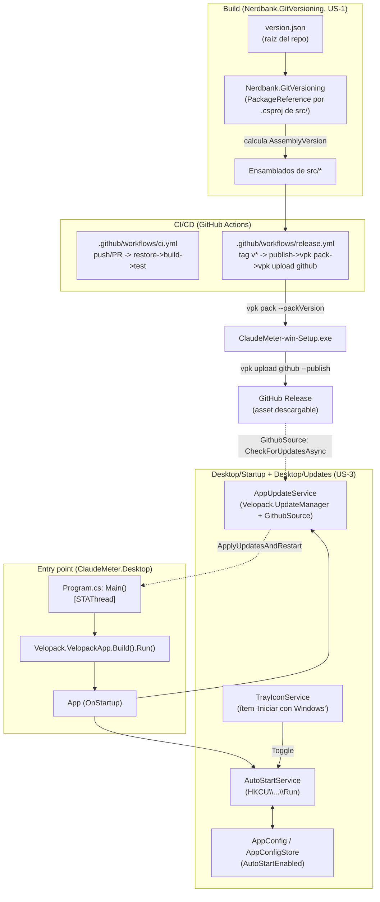
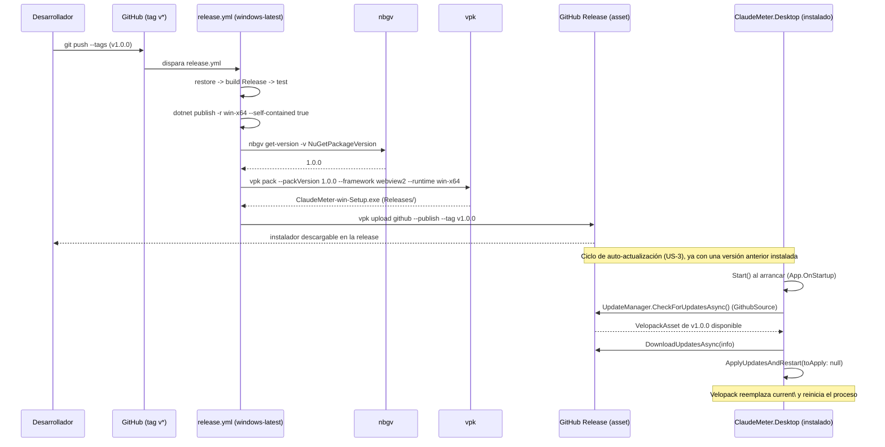
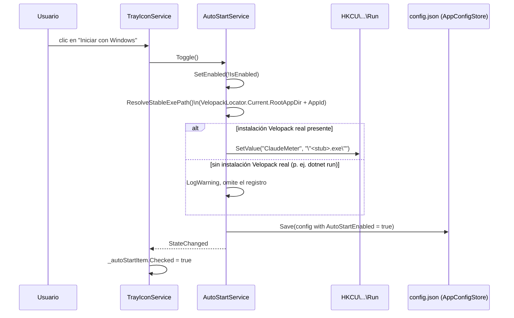

# F6 — Distribución — Documentación Técnica

## Overview

Esta fase cierra el milestone **F6 — Distribución** (GitHub milestone #7),
tres historias encadenadas **US-1 (#27, versionado) → US-2 (#25,
empaquetado) → US-3 (#26, autoarranque + auto-actualización)**. A
diferencia de F1-F3, F6 no toca `ClaudeMeter.Domain` ni
`ClaudeMeter.Application`: es trabajo de build/CI/empaquetado y de ciclo de
vida del *host* de escritorio. Introduce versionado automático
(Nerdbank.GitVersioning), un instalador auto-actualizable (Velopack) y dos
colaboradores nuevos en `ClaudeMeter.Desktop` — `AutoStartService` (registro
de Windows) y `AppUpdateService` (envoltorio de `Velopack.UpdateManager`) —
más dos workflows de GitHub Actions (`ci.yml`, `release.yml`).

## Architecture

## Key Components

- **`version.json`** (raíz del repo) — semilla `"version": "1.0"`,
  `publicReleaseRefSpec` con `^refs/heads/master$` y tags `v\d+\.\d+`. Un
  build en `features/f6` (ni `master` ni tag) queda marcado como no
  público (sufijo de commit/dirty); un tag `v1.0.0` produce la versión
  pública exacta que consume `vpk pack`.

- **`PackageReference` a `Nerdbank.GitVersioning` 3.10.94** repetido en cada
  uno de los 5 `.csproj` de `src/` (Domain, Application, Infrastructure,
  Console, Desktop), `PrivateAssets="all"`. **Desviación del diseño**: el
  documento de diseño pedía centralizarlo en `Directory.Build.props`
  siguiendo el patrón ya usado para TFM/Nullable/analizadores; se detectó
  de forma determinista que un `PackageReference` (condicionado o no) en
  `Directory.Build.props` rompe `dotnet build`/`dotnet restore` a nivel de
  solución con `NETSDK1013` — MSBuild genera un metaproyecto sintético para
  `ClaudeMeter.sln` que también hereda `Directory.Build.props` sin contexto
  de `TargetFramework`, y NuGet intenta resolver igualmente la referencia.
  Se optó por repetir la referencia (comportamiento por defecto de `nbgv
  install` sin consolidar) en vez de depender de una condición MSBuild
  (`Condition="'$(MSBuildProjectExtension)' == '.csproj'"`, que sí evitaba
  el fallo pero no está documentada oficialmente para este caso).

- **`src/ClaudeMeter.Desktop/Program.cs`** (nuevo) — punto de entrada real
  del proceso. `Main()` con `[STAThread]` invoca
  `Velopack.VelopackApp.Build().Run()` como **primera línea**, antes de
  construir `App`, siguiendo la técnica oficial de Velopack para WPF: si
  `Run()` va a terminar el proceso (aplicar una actualización, gestionar un
  evento de instalación), evita inicializar WPF/BlazorWebView de más.
  `App.xaml` deja de ser `ApplicationDefinition` (que generaría su propio
  `Main()` sin permitir código antes de `InitializeComponent()`) y pasa a
  compilarse como `Page` (`Generator=MSBuild:Compile`); el `.csproj` fija
  `<StartupObject>ClaudeMeter.Desktop.Program</StartupObject>`.

- **`src/ClaudeMeter.Desktop/Startup/AutoStartService.cs`** (nuevo) —
  registra/retira `ClaudeMeter` en
  `HKCU\Software\Microsoft\Windows\CurrentVersion\Run`. Resuelve la ruta
  estable del ejecutable vía `Velopack.Locators.VelopackLocator.Current`
  (`RootAppDir` + `AppId`), **nunca** `Environment.ProcessPath`: en
  ejecución normal el proceso corre desde `{RootAppDir}\current\...`,
  carpeta que Velopack reemplaza en cada actualización, mientras que el
  stub `{RootAppDir}\{AppId}.exe` es la única ruta estable entre versiones.
  Guarda explícitamente ante `VelopackLocator.IsCurrentSet == false`
  (proceso sin contexto de instalación Velopack real, p. ej. `dotnet run`
  en desarrollo local) y ante `RootAppDir == null`, registrando un
  `Warning` y omitiendo la escritura en vez de lanzar — necesario porque
  `RootAppDir` es `string?` con `Nullable` habilitado; no estaba explícito
  en el esqueleto del diseño. Persiste el toggle en `config.json` vía
  `AppConfigStore` en cada `SetEnabled`, y expone `ConfigPathForTests`
  (`internal`, `null` por defecto) para que los tests no muten el
  `config.json` real de la máquina.

- **`src/ClaudeMeter.Desktop/Updates/AppUpdateService.cs`** (nuevo) —
  envuelve `Velopack.UpdateManager` + `Velopack.Sources.GithubSource`
  apuntando al repo (`accessToken: null`, `prerelease: false`).
  Comprobación al arrancar (`Start()`, fire-and-forget) + un
  `System.Timers.Timer` de 4h. Comprueba `!_updateManager.IsInstalled`
  antes de nada para omitir la comprobación fuera de una instalación real.
  `catch (Exception ex)` deliberadamente genérico — degradación silenciosa
  exigida por la AC de US-3, superficie de excepciones de Velopack no
  enumerable de forma estable entre versiones del paquete.
  `ApplyUpdatesAndRestart(toApply: null)` aplica automáticamente la última
  versión ya descargada (la API real recibe un `VelopackAsset?`, no el
  `UpdateInfo` que asumía el pseudocódigo del diseño). Constructor
  `internal` adicional que acepta un `UpdateManager` ya construido, y
  `CheckAndApplyForTestsAsync()` (`internal`) para poder esperar el flujo
  de forma determinista en tests — ambos cambios aditivos, el constructor
  público de un argumento no cambia.

- **`src/ClaudeMeter.Desktop/Tray/TrayIconService.cs`** (modificado) —
  nuevo `ToolStripMenuItem _autoStartItem` ("Iniciar con Windows"), mismo
  patrón que `_clickThroughItem` (`CheckOnClick = false`, toggle manual +
  suscripción a `AutoStartService.StateChanged`). A diferencia de
  pausa/click-through, el `Checked` inicial en `Initialize()` sí refleja
  `_autoStart.IsEnabled` (estado ya persistido desde el primer render del
  menú). El constructor gana el parámetro obligatorio `AutoStartService`.

- **`src/ClaudeMeter.Desktop/Configuration/AppConfig.cs` /
  `AppConfigStore.cs`** (modificados) — nuevo campo `AutoStartEnabled`
  (`bool`, por defecto `false`, mismo criterio opt-in que `ChimeEnabled`),
  añadido al final del `record` para compatibilidad con construcciones
  posicionales existentes (mismo patrón que `Theme` en F3). El DTO de
  `AppConfigStore` gana `bool? autoStartEnabled`, resuelto con `??
  AppConfig.Default.AutoStartEnabled` en `Load()`.

- **`.github/workflows/ci.yml`** (nuevo) — `push` (todas las ramas) +
  `pull_request` contra `master`, en `windows-latest`. Un único job:
  `actions/checkout@v7` con `fetch-depth: 0` (obligatorio para que
  Nerdbank.GitVersioning calcule la altura de commits) →
  `actions/setup-dotnet@v6` (.NET 8) → `dotnet restore` → `dotnet build -c
  Release --no-restore` (warnings-as-errors ya configurado, sin paso de
  analizadores aparte) → `dotnet test -c Release --no-build`.

- **`.github/workflows/release.yml`** (nuevo) — trigger `push` con `tags:
  v*`, `permissions: contents: write` explícito (para que `vpk upload
  github --publish` adjunte el asset). Pasos: checkout `fetch-depth: 0` →
  setup .NET 8 → `dotnet tool install --global nbgv`/`vpk` → restore →
  build Release → test → `dotnet publish ... -r win-x64 --self-contained
  true -o publish/` → `nbgv get-version -v NuGetPackageVersion` capturado
  en `GITHUB_OUTPUT` → `vpk pack --packId ClaudeMeter --packVersion
  <versión> --packDir publish --mainExe ClaudeMeter.Desktop.exe
  --packTitle "ClaudeMeter" --runtime win-x64 --framework webview2
  --outputDir Releases` → `vpk upload github --repoUrl ... --token
  $GITHUB_TOKEN --publish --tag <tag>`. `--framework webview2` adjunta el
  WebView2 Evergreen Bootstrapper (~2MB) como prerrequisito de instalación
  — sin él, `BlazorWebView` no arrancaría en una máquina donde el runtime
  no viniese preinstalado (solo garantizado en Windows 11 "elegible").
  `--runtime win-x64` es necesario porque `vpk pack` asume x86 por defecto
  si no se especifica (confirmado con un empaquetado real de prueba).

## Data Flow / Sequence

Flujo del job de `release.yml` al publicar un tag `v*`, hasta que el
usuario recibe la actualización:

Flujo de activación del autoarranque desde la bandeja:

## Edge Cases & Error Handling

- **`version.json` ausente o inválido:** el build de MSBuild falla con un
  error claro de Nerdbank.GitVersioning (AC de US-1) en vez de compilar
  silenciosamente con una versión por defecto — verificado manualmente por
  Development renombrando temporalmente el fichero.
- **Build en rama de feature (no `master`, sin tag):** `publicReleaseRefSpec`
  marca la versión como no pública (sufijo de commit/dirty), evitando
  confundirla con un build de release oficial.
- **`AutoStartService` sin instalación Velopack real** (`dotnet run`/debug
  local, o `RootAppDir == null`): no lanza; registra un `Warning` y omite
  la escritura en el registro — gap de cobertura aceptado en testing
  (requiere `VelopackLocator.SetCurrentLocator`, un setter global sin
  forma de revertirlo dentro del proceso, que contaminaría el resto de la
  batería de tests).
- **Permisos de registro denegados:** `ApplyToRegistry` captura
  específicamente `UnauthorizedAccessException`/`SecurityException`/
  `IOException` con `LogError`, sin lanzar — coherente con el resto de
  servicios de `Windowing`/`Tray`, que nunca interrumpen el ciclo de vida
  de la ventana por un fallo periférico.
- **Comprobación de actualizaciones sin red o con el feed de GitHub
  inaccesible:** `AppUpdateService.CheckAndApplyAsync` degrada en silencio
  (`catch (Exception ex)` genérico, `LogWarning`), sin bloquear ni mostrar
  error intrusivo — mismo patrón que `RetryingUsageDataSource` (F2).
  Confirmado por tests que simulan fallos tanto en `CheckForUpdatesAsync`
  como en `DownloadUpdatesAsync`, incluyendo fallos consecutivos.
- **Ejecución sin instalación Velopack real:** `AppUpdateService` comprueba
  `!_updateManager.IsInstalled` antes de cualquier llamada de red y
  devuelve inmediatamente — evita que `dotnet run` en desarrollo local
  intente comprobar actualizaciones contra un locator inexistente.
- **Instalador incompleto o roto en CI:** `release.yml` no tiene ningún
  paso que ignore errores; un fallo en build/test/publish/`vpk pack`
  detiene el job (comportamiento por defecto de GitHub Actions), por lo
  que nunca se llega a `vpk upload github --publish` con un paquete roto.
- **Push que no es un tag:** el trigger de `release.yml` (`tags: v*`) nunca
  se dispara en un push normal; solo `ci.yml` corre (restore→build→test),
  cumpliendo la AC correspondiente de US-2 por construcción.

## Extension points

- **Firma de código del instalador:** ninguna decisión de este ciclo lo
  bloquea; añadiría un paso de firma antes de `vpk pack` en
  `release.yml`, sin cambios de arquitectura.
- **Cambiar la frecuencia de comprobación de actualizaciones:** un único
  valor (`AppUpdateService.PeriodicCheckInterval`, `TimeSpan.FromHours(4)`).
- **Sustituir el mecanismo de autoarranque** (p. ej. acceso directo en la
  carpeta de inicio en vez de la clave de registro) requeriría solo
  reescribir `AutoStartService.ApplyToRegistry`/`ResolveStableExePath`; el
  contrato (`IsEnabled`, `Toggle()`, `SetEnabled()`, `StateChanged`) ya
  aísla a `TrayIconService` de ese detalle.
- **Deliberadamente sin puerto `IUpdateService`/`IAutoStartService` en
  `ClaudeMeter.Application`:** ambos son colaboradores planos de
  `ClaudeMeter.Desktop`, mismo nivel que `ClickThroughService`/
  `TrayIconService`. No tienen una implementación alternativa plausible
  (no hay "auto-arranque simulado"), así que introducir un puerto aquí
  sería ceremonia sin beneficio — mismo criterio ya aplicado en F1 para
  rechazar MediatR prematuro.

## Estado de tests y validación manual

Según `docs/sdlc/testing/f6-distribucion.md`: **206/206 tests en verde**
en `ClaudeMeter.Desktop.Tests` (182 preexistentes + 24 nuevos: 11
`AutoStartServiceTests`, 6 `AppUpdateServiceTests`, 4 `AppConfigStoreTests`,
3 `TrayIconServiceTests`), con `dotnet build`/`dotnet test` en Debug y
Release (warnings-as-errors) sin advertencias ni errores en los 5
proyectos de `src/`. `AppConfig`/`AppConfigStore` y `TrayIconService`
superan el 70% de cobertura objetivo en cifra bruta; `AppUpdateService`
(91.7% excluyendo líneas inalcanzables sin instalación Velopack real) y
`AutoStartService` (100% del código ejercitable, 34/34 líneas) quedan por
debajo del 70% solo en cifra bruta de Coverlet, por la rama de integración
real con Velopack que no es invocable desde un test unitario aislado sin
mutar estado estático global de un paquete de terceros.

Validado manualmente en este ciclo: build Release con 0 warnings/0
errores, los 206 tests en verde, un instalador real generado y probado con
`vpk pack` (`Releases/ClaudeMeter-win-Setup.exe`), instalación en la
máquina del usuario, el toggle "Iniciar con Windows" de la bandeja y la
escritura efectiva en `HKCU\Software\Microsoft\Windows\CurrentVersion\Run`.
**Pendiente** (Definition of Done, requiere un ciclo real de publicación
de al menos dos releases y/o una máquina Windows limpia sin SDK/Visual
Studio, fuera del alcance de este pipeline de agentes): instalación en una
máquina Windows limpia sin herramientas de desarrollo, publicación real de
un tag con el instalador como asset de una release de GitHub, auto-arranque
tras un reinicio real de Windows, aplicación real de una actualización
entre dos releases consecutivas, y verificación del bootstrapper de
WebView2 en una máquina sin el runtime preinstalado.
